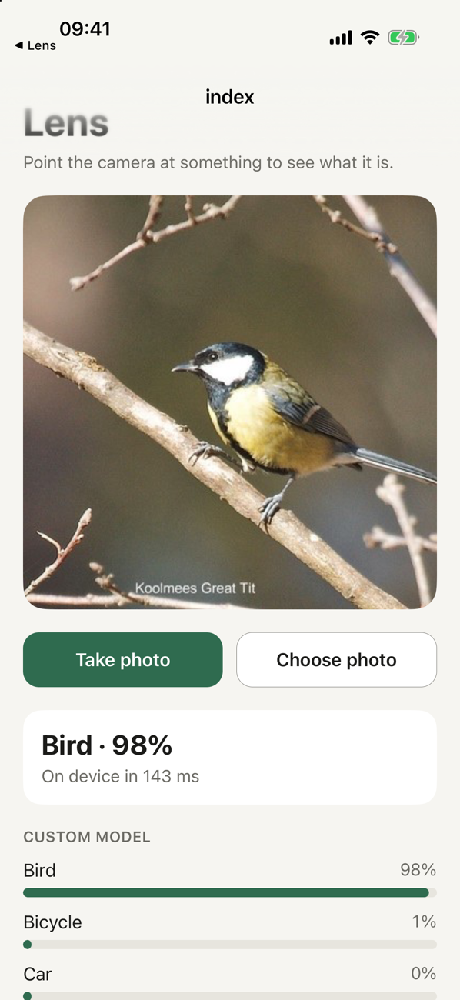
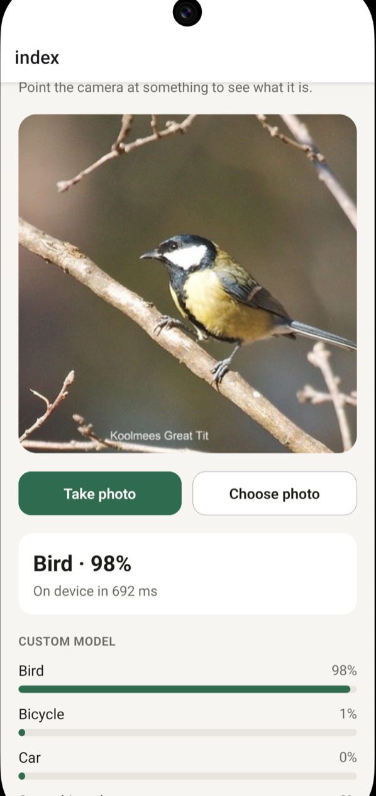

# AI training harness React NAtive

Pick a photo and the app tells you what is in it. The model has been trained to identify birds, cats, dogs, cars, bicycles and flowers.

| iOS (Core ML)                                                                                                 | Android (TFLite)                                                                                                          |
| ------------------------------------------------------------------------------------------------------------- | ------------------------------------------------------------------------------------------------------------------------- |
|  |  |

The model is MobileNetV3 Small, fine-tuned on Open Images. iOS runs it with Core ML, Android with TFLite. For 451 photos:

|                        | Core ML | TFLite |
| ---------------------- | ------- | ------ |
| Top-1                  | 94.5%   | 94.5%  |
| Top-3                  | 99.1%   | 99.1%  |
| Disagrees with PyTorch | 0%      | 0%     |

[MobileNetV3](https://arxiv.org/abs/1905.02244) is an image classification network from Google, designed to run fast on phone CPUs and NPUs. The Small version has about 1.5 million parameters, so the exported model is about 3 MB. Training starts from its ImageNet weights, replaces the last layer with one output for each class, and then fine-tunes all the layers.

## Run the app

You need Bun, Java and Xcode. The compiled model is in the repo, so you do not have to train first.

```bash
cd example-app
bun install
# ios
bunx expo prebuild -p ios && bun run ios -d
# android
bunx expo prebuild -p android && bun run android -d
```

The app is an Expo dev client with a local native module, so it does not run in Expo Go.

| File                                                                                                                                                                                                                                   | What it does                                                                                                                                                    |
| -------------------------------------------------------------------------------------------------------------------------------------------------------------------------------------------------------------------------------------- | --------------------------------------------------------------------------------------------------------------------------------------------------------------- |
| [`example-app/modules/image-classifier/ios/ImageClassifierModule.swift`](example-app/modules/image-classifier/ios/ImageClassifierModule.swift)                                                                                         | Loads the Core ML model, crops and scales the photo, returns the top predictions plus Vision's general labels.                                                  |
| [`example-app/modules/image-classifier/android/src/main/java/expo/modules/imageclassifier/ImageClassifierModule.kt`](example-app/modules/image-classifier/android/src/main/java/expo/modules/imageclassifier/ImageClassifierModule.kt) | The Android module: runs the custom model on a background thread, plus ML Kit image labelling for the general labels.                                           |
| [`example-app/modules/image-classifier/android/src/main/java/expo/modules/Classifier.kt`](example-app/modules/image-classifier/android/src/main/java/expo/modules/Classifier.kt)                                                       | Loads `Classifier.tflite` and `labels.txt` with LiteRT, applies EXIF orientation, crops the centre square, scales it to 224 px and returns the top predictions. |
| [`example-app/modules/image-classifier/util.ts`](example-app/modules/image-classifier/util.ts)                                                                                                                                         | `classifyImage` and `getModelLabels`.                                                                                                                           |
| [`example-app/src/lib/ai.ts`](example-app/src/lib/ai.ts)                                                                                                                                                                               | Turns predictions into an answer: a match, "not sure" below `minConfidence`, or nothing.                                                                        |

## Train the model

The pipeline is in [`training-harness/`](training-harness).

```bash
cd training-harness
uv sync
uv run python download.py      # Open Images photos for the classes in dataset.json
uv run python train.py         # data/out/classifier.pt
uv run python evaluate.py torch
cd .. && scripts/build-model.sh
```

- `dataset.json` sets the classes, photos per class, holdout percent and the minimum box size. An image gets a label only when one class is in it and its box is large enough. A photo of none of the classes becomes `other`.
- `download.py` splits train and holdout by a hash of the image ID, so a photo never moves between them. `data/manifest.jsonl` records the licence and author of every file.
- `scripts/build-model.sh` exports Core ML and TFLite, scores both on the holdout set, and copies them into the native module. It stops if top-1 is below `MIN_TOP1` (default 0.85) or an export disagrees with PyTorch on more than 1% of photos.
- The exported model does the normalization and softmax itself, so the app passes RGB pixels in and reads probabilities out.

Run the tests with `uv run pytest`.

## Credits

- Photos and labels: [Open Images](https://storage.googleapis.com/openimages/web/index.html). The labels are CC BY 4.0; each photo keeps the licence of its author, listed in `data/manifest.jsonl`.
- Model: [MobileNetV3](https://pytorch.org/vision/stable/models/mobilenetv3.html) from torchvision, pretrained on ImageNet.
